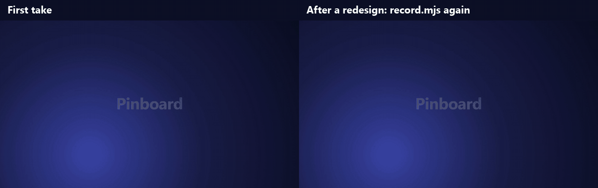
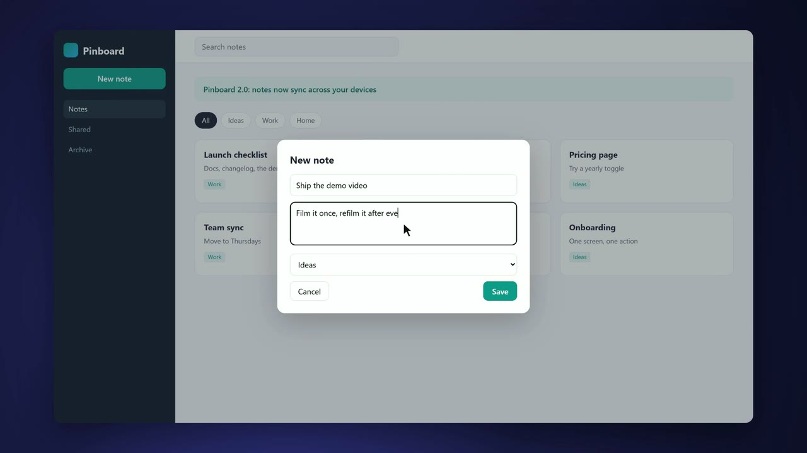

# web-demo

An [OpenFilm](https://github.com/openfilm/openfilm) skill: film a demo of your web product from a list of steps, then
film it again after every release. The edit stays: each clip keeps its place and its length in `film.html`.



Left: a 15-second cut made in OpenFilm from one take of a notes app. Right: the app was redesigned (a sidebar, a
banner, new colors), `record.mjs again` filmed the same steps, and the same cut plays the new take. Nothing in the
edit was touched by hand. [demo/](demo) has the site, the steps and the film; `node demo/make.mjs` rebuilds this.

| | | |
| --- | --- | --- |
|  | [Web demo you can refilm](skills/web-demo) | A demo filmed from your live web product by steps, and filmed again after each release with the cut kept. |

## Use it

- **In OpenFilm**: open Skills, add one from a link, and paste `https://github.com/WEBGRS/openfilm-web-demo`. Then
  ask for a demo of your site.
- **In your own agent** (Claude Code, Codex and others): `npx skills add WEBGRS/openfilm-web-demo`.

It needs Node 22 or later, Google Chrome or Microsoft Edge, and ffmpeg on the PATH (OpenFilm needs ffmpeg too).
Nothing else is installed: the script has no dependencies.

## What the agent gets

`skills/web-demo/scripts/record.mjs`, run with node:

```sh
node record.mjs https://example.com assets/signup.mp4 --steps signup.json   # film a take
node record.mjs again assets/signup.mp4                                     # film it again, move its clips
node record.mjs inspect https://example.com                                 # what can be pointed at, with selectors
node record.mjs inspect https://example.com --steps open-menu.json          # the same, after doing some steps
```

Steps are a JSON list: `click`, `hover`, `fill`, `type`, `press`, `select`, `scroll`, `scrollTo`, `wait`, `idle`,
`until`, `goto` and `mark`. `--help` lists them all with the options (`--size`, `--scale`, `--dark`, `--hide`...).

A take writes three files beside the video:

- `signup.record.json`: what to film (address, steps, size) and what happened (when each step began, every pointer
  move, click and key). Change the steps here and run `again` to film something different.
- `signup.cursor.html`: an OpenFilm page that draws the pointer and its clicks. Put it on the track above the video
  with the same `at`, `#t=` and box, and it follows the take. The video itself has no pointer, so you can restyle
  or drop it. A page plays at one speed, so for a clip you want to speed up, film the take with `--pointer`: the
  pointer is then drawn into the video.
- `signup.mp4`: H.264, 30 fps, 2880 x 1620 at the default 1440 x 810 window and scale 2.

The page runs on a virtual clock: time moves one frame per captured frame, for `requestAnimationFrame`, timers,
`Date`, `performance.now()` and CSS animations. A slow machine gives the same smooth take, and the same steps give
the same pointer path every time. Filming takes six to seven times the take's length at scale 2, and about one and
a half times at `--scale 1`.

## How `again` keeps the edit

Every clip of a take (the video and its cursor page) starts inside some step or mark. `again` films the same steps,
finds that step or mark in the new take, and moves the clip's `#t=` by as much as it moved. The clip's length on
the film does not change, and neither does anything else in `film.html`. A clip whose step or mark is not in the new
take, or that would run past the new end, is listed and left as it was. `--dry-run` shows the changes without making
them. If a step can no longer be done (a button was renamed), `again` stops and the old take stays.

## Limits

- Web pages only, in a headless browser: no desktop apps, no browser extensions, no signed-in profile. Sign in
  through the steps with a demo account; the steps are saved in plain text.
- A link that opens a new tab is not followed: `goto` its address instead.
- Iframes run in real time; only the top page is on the virtual clock.

## Develop

```sh
npm test            # unit tests, then real takes in Chrome or Edge (about two minutes)
npm run check       # the skill folder against OpenFilm's skill rules
```

## Credits

The recorder comes from [Cutroom](https://github.com/WEBGRS/cutroom). `scripts/check.mjs` is adapted from
[openfilm/skills](https://github.com/openfilm/skills) (MIT).

## License

[MIT](LICENSE)
